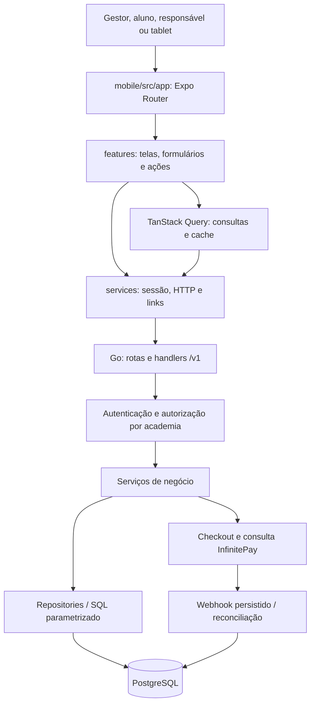
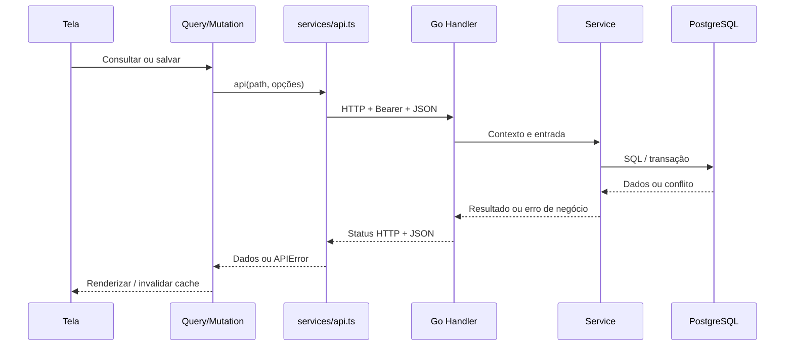

# Mapa do código TatameMix

Retrato da implementação em 28/10/2026. Este guia descreve o código existente; não é teste de carga nem certificação de segurança. Os nomes internos tatame/backend e tatame-mobile são identificadores técnicos antigos.

## Visão geral



O React executa no navegador ou no aparelho; ambos consomem a mesma API. No container final executa o Go: entrega o portal web e atende a API. PostgreSQL está fora dele.

## Pastas e seus papéis

```text
App-jiujitsu/
├── Dockerfile                 portal web + API
├── .dockerignore              exclui segredos e builds locais
├── backend/
│   ├── cmd/api/main.go         entrada do servidor e workers
│   ├── cmd/seed/               programa de seed
│   ├── cmd/demo/               cenários de demonstração
│   ├── internal/
│   │   ├── httpapi/            HTTP, middleware, OpenAPI e portal
│   │   ├── config/             variáveis de ambiente
│   │   ├── database/           pool e migrations/*.sql
│   │   ├── core/               erros, JSON, paginação e validações
│   │   └── ...                funcionalidades na tabela abaixo
│   ├── go.mod                 módulo e dependências
│   └── go.sum                 verificação das dependências
├── mobile/
│   ├── src/app/                URL → componente de rota
│   ├── src/features/           telas e comportamento por assunto
│   ├── src/services/           HTTP, sessão e navegação
│   ├── src/components/         controles e estruturas compartilhados
│   ├── src/hooks/              responsividade e foco
│   ├── src/theme/              cores, fontes e marca
│   ├── src/types/              contratos e funções da apresentação
│   ├── tests/                  testes de lógica frontend
│   ├── package.json            dependências e comandos npm
│   └── package-lock.json       versões resolvidas para npm ci
└── docs/                       decisões, execução e estudos
```

cmd contém executáveis; internal contém pacotes privados ao módulo Go. Uma pasta com arquivos .go forma um pacote. main() inicia o programa. Um método como Manager.Run pertence a um tipo e recebe estado por seu receiver.

## Inicialização do backend: ordem para ler

1. backend/cmd/api/main.go → main monta a aplicação.
2. internal/config/config.go → Load lê .env quando presente; variáveis do processo prevalecem.
3. internal/database/database.go → Migrate aplica SQL Goose incorporado por go:embed.
4. No mesmo arquivo, Open cria pgxpool.Pool e verifica conexão com Ping.
5. payments.Load e LoadInfinitePay carregam configuração dos pagamentos.
6. httpapi.NewWithPayments monta serviços, middlewares e rotas.
7. httpapi.WithPortal separa API e arquivos do site.
8. payments.Manager.Run executa geração e reconciliação em paralelo ao HTTP.
9. ListenAndServe atende conexões; SIGTERM inicia desligamento HTTP com prazo de 10s.

## Módulos backend

| Pasta em backend/internal | Responsabilidade / pontos para estudar |
| --- | --- |
| httpapi | server.go: rotas, CORS, rate limit, logs; dashboard.go: indicadores; portal.go: site; openapi.json: contrato HTTP. |
| auth | Cadastro/login, bcrypt, token opaco, sessão revogável e middleware. |
| access | Academia e papéis ativos; students.go autoriza aluno e responsável. |
| academies | Cadastro da academia, vínculo do criador e lista acessível. |
| memberships | Papéis, solicitações legadas, gestores adicionais e proteção do último gestor. |
| students | Aluno, planos/modalidades, graduação, contrato, arquivo/restauração, convites; shared_* cuida do link público. |
| participation | Pessoa na academia, CPF, código e QR sem obrigar gestor a ter matrícula financeira. |
| classes | Turmas recorrentes, horários semanais e ocorrências em datas específicas. |
| attendance | Check-in, idempotência, presença manual, elegibilidade e históricos. |
| devices | Credenciais próprias do tablet e revogação. |
| billing | GenerateTx, GenerateFirstTx, Generate, List e Get: mensalidades, vencimento e centavos. |
| subscriptions | Assinatura do software: R$ 450 por academia, checkout da plataforma, tolerância, histórico e restrição de escrita. Ver SUBSCRIPTIONS.md. |
| payments | Manager, checkout, cliente InfinitePay, criptografia, eventos/reconciliação, descontos/baixa manual e legado Asaas. |
| database | Pool pgx, Goose e migrações versionadas. |
| config | Configuração de execução/local. |
| core | Decode, Write, Fail, Pagination, contexto autenticado, CPF e idade. |
| demodata | Cenários de demonstração; não é rotina de produção. |

O desenho predominante é handler → service → repository → SQL. Não é uma arquitetura rigidamente uniforme: pagamentos e matrículas também possuem SQL/transações em serviços. Siga a função real; nem toda consulta está obrigatoriamente em repository.go.

- Handler traduz HTTP e JSON, chama o serviço e devolve status/resposta.
- Service decide regras, permissões e coordena passos.
- Repository lê/escreve no PostgreSQL usando parâmetros SQL.
- Model/struct define os dados e entradas.

## Caminho de uma ação



Para estudar cadastro: StudentsScreen.tsx → StudentForm.tsx → chamada api(...) → procure a URL em httpapi/server.go → vá à definição do handler e métodos chamados. academyPath monta o prefixo da academia.


## Rotas HTTP do backend

O registro executável está em backend/internal/httpapi/server.go. O contrato completo está em [OpenAPI incorporado à API](../backend/internal/httpapi/openapi.json), servido em /openapi.json. Na tabela, A significa /v1/academies/{academy}.

| Área | Exemplos de métodos e rotas |
| --- | --- |
| Sessão | POST /v1/auth/register, /login, /logout; GET /v1/me |
| Academias | POST /v1/academies; GET /v1/me/academies |
| Gestores/vínculos | GET/POST A/managers; GET/PATCH A/members |
| Alunos | GET/POST A/students; GET/PATCH A/students/{student}; POST archive/restore |
| Catálogo | GET/POST/PATCH A/modalities e A/plans |
| Matrícula pública | GET /v1/enrollment-links/{token}; POST /v1/enrollment-links/{token}/enroll |
| Revisão/acesso | GET/PATCH A/enrollment-requests; GET A/me/students; GET A/portal-access |
| Turmas | GET/POST A/classes; PATCH/DELETE A/classes/{class}; GET/POST schedules |
| Aulas/presença | GET A/attendance-options; POST A/check-ins e A/attendances; GET A/attendances |
| Tablets | GET/POST A/devices; DELETE A/devices/{device} |
| Mensalidades | GET A/invoices e A/me/invoices; GET A/invoices/{invoice} |
| Ajustes | PATCH A/invoices/{invoice}/discount e /cancel; POST /manual-payment |
| Recebimentos | GET/PUT/PATCH A/payment-integration; POST A/invoices/{invoice}/checkout e /payment-check |
| Webhook | POST /v1/webhooks/infinitepay/{connection} |
| Operação | GET /healthz e /openapi.json |

Os nomes de parâmetros podem variar entre o registro e a documentação. Estes são exemplos para orientar a busca, não uma lista exaustiva nem autorização por si só. Consulte o handler e access para a permissão de cada ação.

## Frontend e rotas

src/app/_layout.tsx monta fontes, SafeArea, QueryClientProvider, SessionProvider e Stack. O layout de (app) exige sessão e monta SectionPagesProvider. Parênteses agrupam arquivos sem aparecer na URL; [id] e [token] são parâmetros.

services/session.tsx mantém sessão, academia e papel. SecureStore guarda a sessão no nativo; sessionStorage na web. Preferência de academia/papel é conferida contra a resposta atual da API. Logout/troca de sessão limpa o cache.

services/api.ts monta Bearer, JSON, Idempotency-Key opcional, prazo de 15 segundos e APIError. api-url.ts resolve origem; access.ts decide destinos autorizados; safe-next.ts conserva navegação interna após login; checkout-flow.ts e open-payment.ts organizam checkout.

AcademyShell.tsx escolhe lateral no amplo e barra inferior nas larguras menores. hooks/useResponsiveLayout.ts define <768 compacto, 768–1023 intermediário e ≥1024 amplo. O pager não é montado no amplo. Desktop e celular compartilham estado, API e regras; arquivos .web resolvem diferenças reais de plataforma.

### Rotas existentes

A tabela abaixo é extraída dos arquivos atuais. Algumas são compatibilidade/redirecionamento. A existência de uma página não concede acesso aos dados: a API verifica autorização.


| URL | Arquivo de rota | Implementação |
| --- | --- | --- |
| /academies | [mobile/src/app/(app)/academies.tsx](../mobile/src/app/(app)/academies.tsx) | onboarding/AcademyPickerScreen |
| /academy | [mobile/src/app/(app)/academy/index.tsx](../mobile/src/app/(app)/academy/index.tsx) | academy/AcademyScreen |
| /academy-history | [mobile/src/app/(app)/academy-history.tsx](../mobile/src/app/(app)/academy-history.tsx) | attendance/HistoryScreen |
| /attendance/[id] | [mobile/src/app/(app)/attendance/[id].tsx](../mobile/src/app/(app)/attendance/[id].tsx) | teacher/AttendanceScreen |
| /attendance-day | [mobile/src/app/(app)/attendance-day.tsx](../mobile/src/app/(app)/attendance-day.tsx) | attendance/LessonScreen |
| /catalog | [mobile/src/app/(app)/catalog.tsx](../mobile/src/app/(app)/catalog.tsx) | academy/CatalogScreen |
| /classes | [mobile/src/app/(app)/classes.tsx](../mobile/src/app/(app)/classes.tsx) | classes/ClassesScreen |
| /create-academy | [mobile/src/app/(app)/create-academy.tsx](../mobile/src/app/(app)/create-academy.tsx) | onboarding/CreateAcademyScreen |
| /devices | [mobile/src/app/(app)/devices.tsx](../mobile/src/app/(app)/devices.tsx) | devices/DevicesScreen |
| /enrollment-settings | [mobile/src/app/(app)/enrollment-settings.tsx](../mobile/src/app/(app)/enrollment-settings.tsx) | enrollment/EnrollmentSettingsScreen |
| /entry | [mobile/src/app/(app)/entry.tsx](../mobile/src/app/(app)/entry.tsx) | onboarding/EntryScreen |
| /finance | [mobile/src/app/(app)/finance/index.tsx](../mobile/src/app/(app)/finance/index.tsx) | finance/FinanceScreen |
| /history | [mobile/src/app/(app)/history.tsx](../mobile/src/app/(app)/history.tsx) | attendance/HistoryScreen |
| /invoice/[id] | [mobile/src/app/(app)/invoice/[id].tsx](../mobile/src/app/(app)/invoice/[id].tsx) | finance/InvoiceScreen |
| /kiosk | [mobile/src/app/(app)/kiosk/index.tsx](../mobile/src/app/(app)/kiosk/index.tsx) | kiosk/KioskScreen |
| /managers | [mobile/src/app/(app)/managers.tsx](../mobile/src/app/(app)/managers.tsx) | managers/ManagersScreen |
| /more | [mobile/src/app/(app)/more.tsx](../mobile/src/app/(app)/more.tsx) | academy/MoreScreen |
| /onboarding | [mobile/src/app/(app)/onboarding/index.tsx](../mobile/src/app/(app)/onboarding/index.tsx) | onboarding/OnboardingScreen |
| /participation | [mobile/src/app/(app)/participation.tsx](../mobile/src/app/(app)/participation.tsx) | participation/ParticipationScreen |
| /qr | [mobile/src/app/(app)/qr.tsx](../mobile/src/app/(app)/qr.tsx) | shared/AcademyShell, student/StudentScreen |
| /subscription | [mobile/src/app/subscription.tsx](../mobile/src/app/subscription.tsx) | subscription/SubscriptionScreen |
| /receipts | [mobile/src/app/(app)/receipts.tsx](../mobile/src/app/(app)/receipts.tsx) | payments/ReceiptsScreen |
| /student | [mobile/src/app/(app)/student/index.tsx](../mobile/src/app/(app)/student/index.tsx) | student/StudentScreen |
| /students/[id] | [mobile/src/app/(app)/students/[id].tsx](../mobile/src/app/(app)/students/[id].tsx) | students/StudentsScreen |
| /students | [mobile/src/app/(app)/students/index.tsx](../mobile/src/app/(app)/students/index.tsx) | students/StudentsScreen |
| /teacher | [mobile/src/app/(app)/teacher/index.tsx](../mobile/src/app/(app)/teacher/index.tsx) | Entrada/redirecionamento: ver arquivo |
| /login | [mobile/src/app/(auth)/login.tsx](../mobile/src/app/(auth)/login.tsx) | auth/AuthScreen |
| /register | [mobile/src/app/(auth)/register.tsx](../mobile/src/app/(auth)/register.tsx) | auth/AuthScreen |
| /enroll/[token] | [mobile/src/app/enroll/[token].tsx](../mobile/src/app/enroll/[token].tsx) | enrollment/EnrollmentScreen |
| /enrollment-status | [mobile/src/app/enrollment-status.tsx](../mobile/src/app/enrollment-status.tsx) | enrollment/EnrollmentStatusScreen |
| / | [mobile/src/app/index.tsx](../mobile/src/app/index.tsx) | Entrada/redirecionamento: ver arquivo |
| /invite/[token] | [mobile/src/app/invite/[token].tsx](../mobile/src/app/invite/[token].tsx) | access/InvitationScreen |
| /pay/[academyId]/[invoiceId] | [mobile/src/app/pay/[academyId]/[invoiceId].tsx](../mobile/src/app/pay/[academyId]/[invoiceId].tsx) | access/PaymentLinkScreen |

## Onde procurar as telas

| Assunto | Caminho dentro de mobile/src/features |
| --- | --- |
| Login | auth/AuthScreen.tsx e AuthLayout.tsx |
| Entrada e academias | onboarding/EntryScreen.tsx e AcademyPickerScreen.tsx |
| Painel | academy/AcademyScreen.tsx |
| Lista/cadastro | students/StudentsScreen.tsx, StudentsTable.tsx, StudentProfile.tsx e StudentForm.tsx |
| Evolução | students/StudentProgress.tsx e StudentStartDateEditor.tsx |
| Presenças do aluno | students/StudentAttendances.tsx e StudentAttendanceOverview.tsx |
| Financeiro | finance/FinanceScreen.tsx, FinanceFilters.tsx e InvoicesTable.tsx |
| Mensalidade | finance/InvoiceScreen.tsx, InvoiceActions.tsx e payments/CheckoutPanel.tsx |
| Grade semanal | classes/ClassesScreen.tsx, WeeklyTimetable.tsx e WeeklyEditor.tsx |
| Histórico | attendance/HistoryScreen.tsx, HistoryFilters.tsx e HistoryList.tsx |
| Tablet | kiosk/KioskScreen.tsx, KioskCamera.tsx e KioskPanels.tsx |
| Matrícula pelo link | enrollment/EnrollmentScreen.tsx e EnrollmentSettingsScreen.tsx |
| Família/aluno | student/StudentScreen.tsx e useStudentScope.tsx |
| Recebimentos | payments/ReceiptsScreen.tsx |
| Gestores/tablets autorizados | managers/ManagersScreen.tsx e devices/DevicesScreen.tsx |

## Dados: identidade não é matrícula

- people: identidade canônica e email único quando informado.
- users: conta de login ligada à pessoa.
- memberships + membership_roles: papéis por academia.
- academy_participants: participação, CPF, número e QR por academia.
- students: matrícula comercial, opcional para quem só administra/participa.
- student_billing: configuração atual de valor, vencimento e geração.
- invoices: mensalidades emitidas com valor/vencimento preservados.
- student_guardians: vínculo autorizado entre responsável e alunos.
- classes + class_schedules: grade recorrente; class_sessions: ocorrência numa data.
- attendances: presenças; graduation events: evolução por modalidade.
- payment_connections, checkout_attempts, checkout_inbox e payment_receipts: configuração e rastreabilidade dos pagamentos.

Este é um mapa conceitual; as migrações são a fonte das colunas e foreign keys exatas. Uma conta de gestor não é necessariamente aluno pagante. Responsável pode acessar vários filhos sem virar matrícula financeira. CPF conhecido não basta para ganhar acesso ao histórico.

## Três fluxos para estudar

### Matrícula pelo link

EnrollmentScreen → preview da academia/ofertas → login/cadastro → POST enrollment-links/{token}/enroll → students/shared_handler.go, shared_enrollment.go e shared_link.go → identidade, matrícula, vínculo e primeira mensalidade.

CPF novo na academia pode ativar matrícula; CPF existente gera solicitação de acesso revisada pelo gestor. Dia de vencimento vem da escolha do aluno; valor é resolvido no servidor.

### Presença

KioskScreen → opções de turma/horário → código/QR → /check-ins → autorização do dispositivo + elegibilidade + horário → gravação idempotente. Gestor tem rota de presença manual. O tablet usa sua credencial, não precisa guardar a sessão pessoal do gestor.

### Pagamento

InvoiceScreen → checkout-flow → /invoices/{id}/checkout → autorização/valor/lease → tentativa persistida → InfinitePay → checkout hospedado. Webhook entra na caixa persistente; a API consulta o provedor, confere referência/valor e registra recebimento. Retorno do navegador não comprova quitação.

## Memória e desempenho: evidências e limites

| Evidência no código | O que significa |
| --- | --- |
| Imagem final roda binário Go e arquivos estáticos | Node/Expo não ficam consumindo RAM do servidor. Navegador/aparelho têm seu próprio consumo. |
| database.Open usa pgxpool.New sem ajuste explícito | Pool usa padrões ou parâmetros da conexão. Dimensionar por banco e número de réplicas requer medição. |
| core.Decode limita JSON a 65.536 bytes | Limita essas entradas; não é limite da RAM total do processo. |
| core.Pagination: 25 por padrão, máximo 100 | Limita listas que usam esse helper, não todas as consultas internas. |
| HTTP com timeouts e InfinitePay com 15s | Evita parte das esperas indefinidas; não substitui revisar prazo/cancelamento de SQL por operação. |
| QueryClient: staleTime 15s, retry 1, mutações sem retry automático | Evita parte das buscas e repetições de gravação; cache ainda ocupa RAM no cliente. |
| Financeiro usa paginação SQL | Não exige trazer todas as mensalidades para preencher a tela. |
| Inbox/reconciliação InfinitePay: lotes de até 30 por passagem | Limita trabalho por ciclo; acompanhar backlog e tempo até confirmação. |
| billing.Repository.Generate carrega todos os contratos habilitados num slice | Memória e consultas crescem com os contratos. Candidato concreto a processamento em lotes quando houver volume. |
| Worker no início e a cada minuto, sequencial | Não cria uma goroutine por aluno. Ciclo lento atrasa os seguintes; falha na geração pode interromper os contratos restantes naquele ciclo. |
| Rate limiter em map com mutex por processo | Não é distribuído. Validar IP real atrás do proxy e comportamento com réplicas antes de escalar. |

**Não medi RSS, heap, CPU, p95 nem capacidade de usuários nesta entrega.** Compilar e passar testes não demonstra ausência de vazamentos nem prova que está “tudo otimizado”. Não alterei consultas, pool nem GC.

### Como medir

1. Servidor: métricas do Azure ou docker stats com imagem em execução. Observe RAM do container, CPU, reinícios e duração das requisições em repouso e em uso repetido.
2. Go: heap indica objetos vivos; alocações indicam trabalho criado para o GC; goroutines indicam concorrência/esperas. pprof identifica funções responsáveis. O projeto não expõe endpoint pprof atualmente; coleta exige instrumentação local ou profiling de testes.
3. Banco: pgAdmin/Neon para conexões e consultas. EXPLAIN (ANALYZE, BUFFERS) em SELECTs representativos numa base de teste mostra planos e custos; ANALYZE realmente executa a consulta.
4. Web: DevTools → Network, Performance e Memory; React DevTools → Profiler para renderizações. Compare snapshots após repetir o mesmo fluxo e estabilizar.
5. Nativo: React Native DevTools → Components/Profiler e Memory JavaScript. Memória nativa total exige ferramentas da plataforma e não equivale ao heap JS.

Repita login, troca de academia, paginação de alunos, filtros financeiros, abrir/fechar formulários e grade semanal. Registre cenário, volume, duração e versão. Picos isolados não provam vazamento; procure crescimento retido após ciclos repetidos e períodos ociosos.

Não habilite /debug/pprof publicamente. GOMEMLIMIT é um limite **suave do runtime Go**, não teto de RAM/RSS do container; só ajuste após definir orçamento e reservar margem. Também não adicione índices SQL sem verificar planos e volume reais.

## Ferramentas e roteiro de estudo

- **VS Code + extensão Go/gopls:** F12 abre definição, Shift+F12 mostra referências e “Show Call Hierarchy” permite seguir quem chama/é chamado. Chamadas dinâmicas não são totalmente capturadas.
- **GitHub/preview Markdown:** leia este mapa e seus diagramas. Se seu preview local não renderizar Mermaid, use suporte Mermaid no editor ou o Mermaid Live Editor copiando apenas o diagrama.
- **Busca global:** procure URL para ligar frontend a backend; procure tabela para descobrir leituras/escritas.
- **Testes como exemplos:** backend/internal/httpapi/shared_enrollment_test.go, infinitepay_customer_test.go, scheduled_attendance_test.go e mobile/tests.

Roteiro: inicialização → login/sessão → listar alunos → salvar cadastro → link de matrícula → presença → contrato/mensalidade → pagamento. Estude uma ação de ponta a ponta com o teste correspondente. Use banco isolado; iniciar a API real aplica migrações no banco configurado.

## Referências oficiais

- [Diagnósticos e pprof](https://go.dev/doc/diagnostics)
- [Go: memória e garbage collector](https://go.dev/doc/gc-guide)
- [gopls: navegação e hierarquia de chamadas](https://go.dev/gopls/features/navigation)
- [React Native DevTools](https://reactnative.dev/docs/react-native-devtools)
- [Configuração Azure/Render](AZURE.md)
